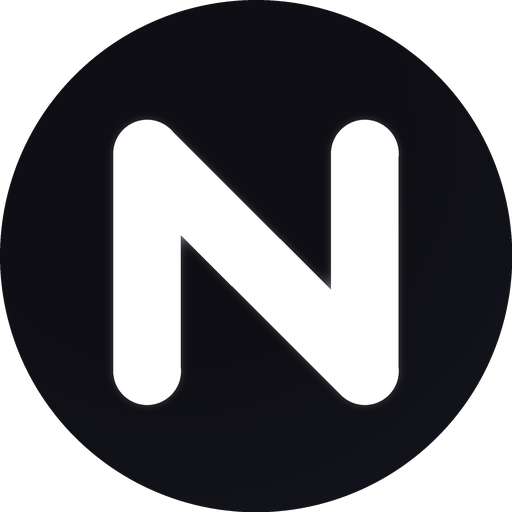

<div align="center">



# Neptune

**Медиаплеер с настоящим liquid glass.**
Тёмный обсидиановый материал + живое стекло + фон в цвет текущего трека.

`Android 8+` · `Kotlin` · `Jetpack Compose` · 100 % нативно

### [⬇ Скачать APK](apk/Neptune.apk) · 6.7 МБ

</div>

---

## Экраны

| Сейчас играет | Медиатека | Поиск | Внешний вид |
| :---: | :---: | :---: | :---: |
|  |  |  |  |

Фон перекрашивается под палитру трека — от ледяного синего до янтарного:


---

## Что внутри

**Живое стекло (liquid glass), а не просто «полупрозрачный прямоугольник».**
Каждая панель — это четыре слоя материала:

1. **Backdrop blur** — панель рисует тот же самый aurora-фон, что и экран, в root-координатах,
   и размывает его через `RenderEffect` (Android 12+). То есть стекло действительно преломляет
   то, что за ним, а не имитирует это полупрозрачностью.
2. **Материал** — тонировка + световой лифт (белый 6 %) + лёгкая глубина.
3. **Спекулярная кромка** — 1 px градиентный блик по контуру (свет сверху-слева) + внутреннее свечение.
4. **Зерно** — плёночный noise-слой в `Overlay`, чтобы стекло не выглядело «цифровым».

Силуэт — не `RoundedCornerShape`, а **squircle** (непрерывная кривизна углов, как в iOS 26 / TG 2026):
углы скруглены кубическими кривыми, поэтому границы «текут», а не ломаются.

**Фон в цвет трека.** У каждого трека своя палитра из трёх цветов; пять aurora-капель медленно
двигаются по экрану, а при смене трека палитра плавно интерполируется (`animateColorAsState`).
Все стеклянные панели сэмплируют именно этот фон — поэтому цвет трека буквально проходит через интерфейс.

**Пилюли вместо прямоугольников.** Транспорт, громкость, тумблеры, сегменты, навбар — всё капсулы.
Свой `PillToggle` (капсульный переключатель с бликом и ореолом), свой слайдер с плазменным заполнением,
свой навбар с перетекающей линзой выделения.

**Своя иконографика.** 30+ иконок нарисованы кодом в сетке 24×24 (`ui/Icons.kt`) — никаких стоковых
ассетов, всё в одном штрихе и с одинаковыми радиусами.

**Обложки генерируются процедурно** из палитры трека: градиенты, кольца, блик, зерно.
Ни одного битмапа — поэтому обложки всегда идеально совпадают с фоном.

---

## Полная кастомизация

Экран **«Внешний вид»** (вкладка справа в навбаре) меняет интерфейс в реальном времени,
всё сохраняется в `SharedPreferences` и переживает перезапуск:

| Группа | Параметры |
| --- | --- |
| **Акцент** | 7 тонов: Лёд, Аврора, Неон, Закат, Золото, Роза, Небо |
| **Стекло** | Размытие (0–44 dp), Плотность (0–42 %), Радиус (8–36 dp) |
| **Сцена** | Насыщенность фона (0–160 %), Скорость волн (×0.25–×2.5) |
| **Переключатели** | Анимации · Свечение · Зерно · Плавающий навбар · Вибрация · Мини-плеер · Время трека · Кольца обложки · Подписи в навбаре |
| **Сброс** | Одна кнопка возвращает дефолт (акцент сохраняется) |

---

## Технологии

- **Kotlin 2.0 + Jetpack Compose** — самый быстрый практичный стек для Android:
  нет JVM-моста на кадр, нет WebView, нет JS-рантайма. Интерфейс рисуется на GPU,
  анимации идут на `withFrameNanos` (кадр-в-кадр), тяжёлые эффекты — в draw-фазе
  (перерисовка слоя без рекомпозиции).
- **RenderEffect / Skia blur** — настоящее размытие подложки на API 31+; на API 26–30
  материал деградирует до усиленной тонировки (стекло остаётся читаемым).
- **AGP 8.7 · compileSdk 35 · minSdk 26 · targetSdk 35**, edge-to-edge, без лишних зависимостей —
  в APK только Compose, core-ktx и четыре начертания шрифта.
- **Шрифт** — Manrope (OFL), четыре начертания (400/600/700/800), латиница + кириллица,
  сведённые в один TTF на вес. Заголовки — ExtraBold с отрицательным трекингом.
- **Иконка** — adaptive icon: почти чёрный радиальный градиент + белая монограмма **N**
  (одна толщина штриха, круглые торцы, лёгкий ореол). Есть monochrome-слой для тематических иконок Android 13+.

---

## Установка

1. Скачайте [`apk/Neptune.apk`](apk/Neptune.apk) на телефон.
2. Разрешите установку из этого источника (Android спросит сам).
3. Откройте **Neptune**.

Требуется Android 8.0+ (API 26). Полный liquid glass с размытием — Android 12+.

> Подпись: собственный keystore `app/neptune.jks` (пароль `neptune`), поэтому обновления
> ставятся поверх без переустановки. Ключ лежит в репозитории намеренно — это демо-сборка.

---

## Сборка из исходников

```bash
gradle assembleRelease
# → app/build/outputs/apk/release/app-release.apk
```

APK в репозитории собирается автоматически в GitHub Actions
([`.github/workflows/build.yml`](.github/workflows/build.yml)) и коммитится в `apk/`.

---

## Дорожная карта

Сейчас это **фронтенд-демо**: библиотека из 8 демо-треков, воспроизведение симулируется
(позиция, прогресс, автопереход, shuffle/repeat работают по-настоящему как UI-логика).

Дальше:

- [ ] Media3 / ExoPlayer — реальное воспроизведение и медиасессия с уведомлением
- [ ] Сканирование локальных файлов (`MediaStore`) + обложки из тегов
- [ ] Экран очереди и очередь воспроизведения
- [ ] Эквалайзер через `AudioEffect` с реальным спектром в фоне
- [ ] Виджет и Android Auto

---

<div align="center">

**Neptune** — тишина, стекло и цвет.

</div>
